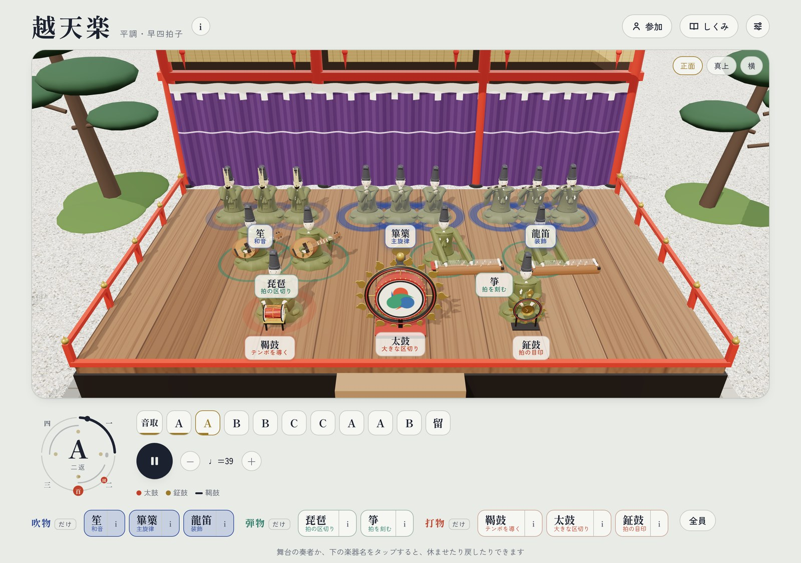
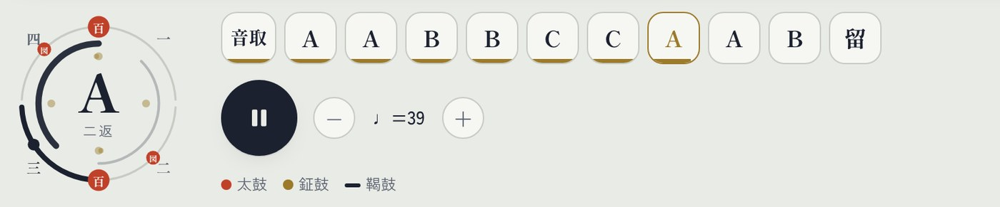
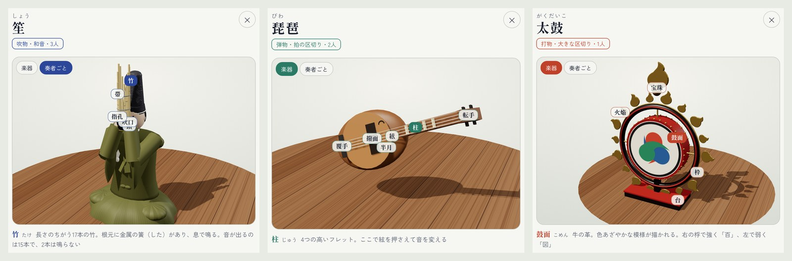
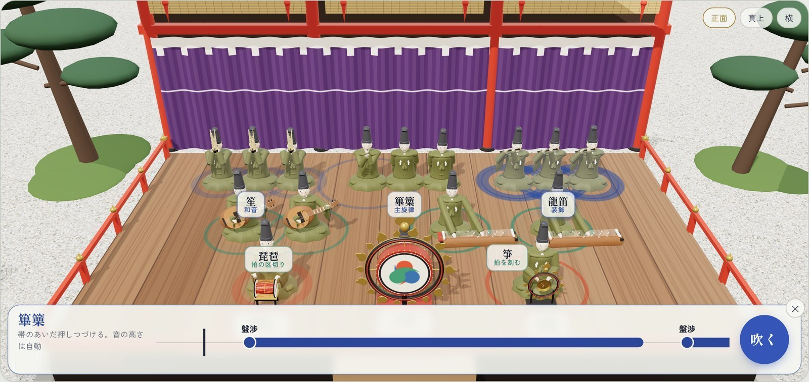
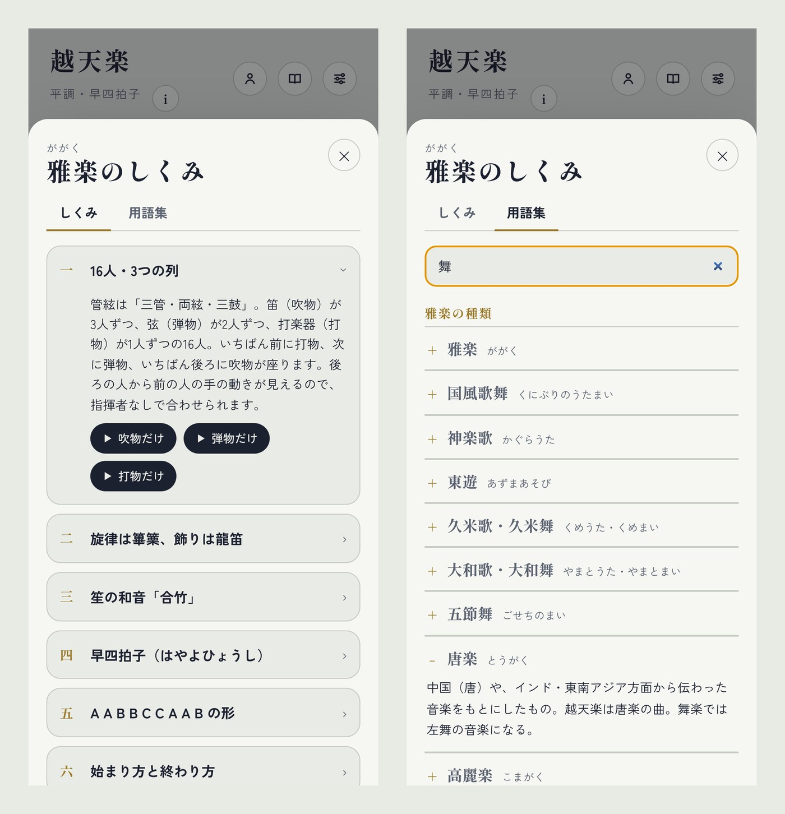
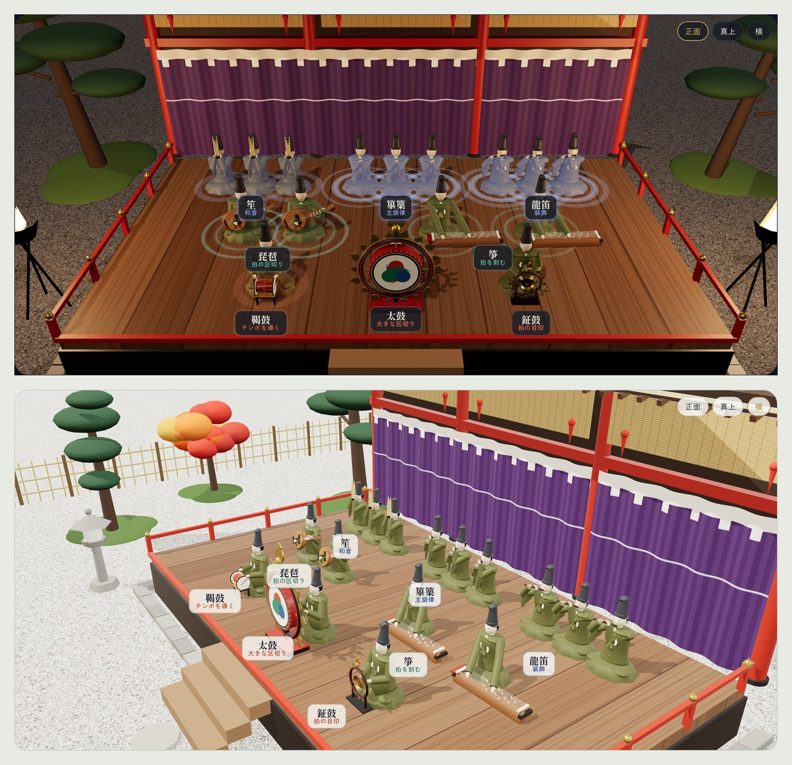
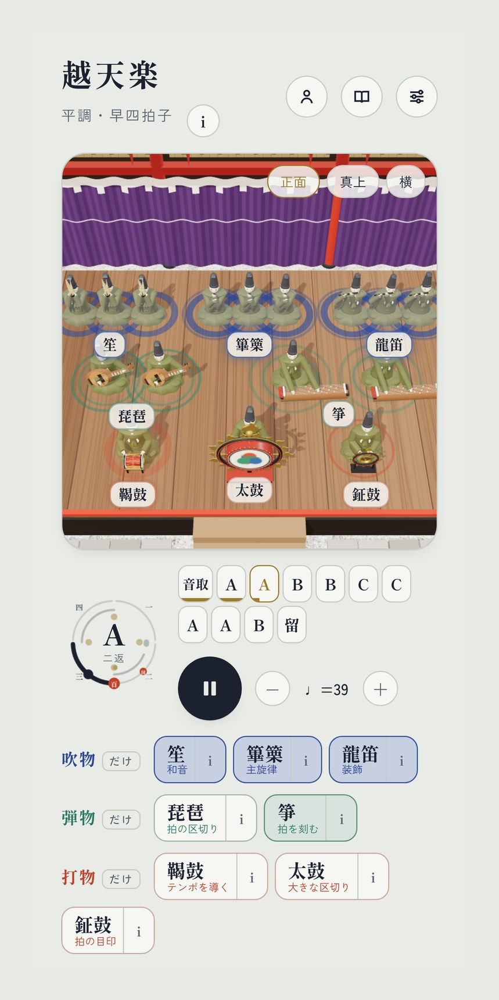

# 3Dの雅楽隊と『越天楽』を合奏できるWebアプリを作りました｜いま誰が演奏しているか、光で見える

<!-- 見出し画像：images/00_header.jpg -->

音楽の授業で雅楽を扱うとき、いつも困ることがありました。

録音を聴かせても、「いま鳴っているのはどの楽器？」「笙と篳篥はどうちがうの？」が、生徒にはなかなか伝わらないのです。映像でも、16人が並んで座っていると、誰が音を出しているのか見分けるのは大変です。

そこで、3Dの雅楽隊が『越天楽』を演奏し、いま誰が鳴らしているかが光で見えるWebアプリを作りました。ブラウザで開くだけで、パソコンでもスマホでも動きます。

👉 【ここにURLを貼る】

---

## 16人の雅楽隊が、目の前で演奏する

舞台には、本番と同じ16人の奏者が座っています。後ろの列に吹物（笙・篳篥・龍笛 各3人）、まん中に弾物（琵琶・箏 各2人）、前に打物（鞨鼓・太鼓・鉦鼓）。いわゆる「三管両絃三鼓」の編成です。

*演奏中の画面。音を出している奏者の足もとに光の輪が広がります。吹物は青、弾物は緑、打物は赤*

演奏している奏者の足もとには、色つきの光の輪が広がります。だから「いま篳篥が旋律を吹いている」「ここで太鼓がドンと鳴った」が、目でわかります。

奏者か楽器名をタップすると、その楽器だけ休ませることができます。「吹物だけ」「打物だけ」のように一つのグループだけを聴くこともできるので、パートごとの役割を聴き比べる授業にも使えます。

## 本物の『越天楽』にこだわりました

旋律を想像で作ることはせず、越天楽の楽譜データ（MIDI）から全パートを取り込みました。篳篥・龍笛の旋律、笙の合竹（和音）、琵琶・箏、鞨鼓・太鼓・鉦鼓まで、すべて楽譜どおりです。

さらに、実際の演奏の録音を解析して、本物に近づけました。

- 速さ：1拍およそ1.5秒（♩≒39）。後半の「加拍子」からは少し速くなる（♩≒44）
- 音の高さ：A＝440Hz（平調）
- 音色と音量のバランス：録音の倍音や響きの長さに合わせて調整
- 入りの順番：龍笛の「音頭」の独奏から始まり、打物 → 笙・篳篥 → ほかの管と琵琶 → 箏 と、順に加わっていく
休みの奏者は楽器を膝に下ろし、出番が来ると構え直します。音はすべてブラウザの中で合成しているので、録音ファイルは使っていません。

## 拍子と形式が、ひと目でわかる

画面の下には「拍子の輪」と、曲の形式（A A B B C C A A B ＋留）が並んでいます。

*左の輪は小拍子の4拍を一周で表します。太鼓・鉦鼓・鞨鼓の打つ位置に印があり、今どこを演奏しているかが一目でわかります*

雅楽のリズムの要は太鼓です。弱く打つ「図（ずー）」と、2拍あとに強く打つ「百（どう）」。輪の上でその位置を見ながら聴くと、ゆったりした雅楽の拍の流れがつかみやすくなります。A・B・Cのボタンを押せば、好きな段から聴くこともできます。

## 楽器を手に取るように、拡大して見られる

楽器名の「i」ボタンを押すと、その楽器を3Dで拡大して、ぐるぐる回して見られます。奏者ごと表示して、構え方を確かめることもできます。

*左から 笙（奏者ごと表示）、琵琶、太鼓。部分の名前をタップすると、読み方と説明が出ます*

笙の吹口、琵琶の撥面や柱、太鼓の火焔の飾りなど、部分ごとの名前と説明つき。教科書の写真だけではわかりにくい楽器の形が、立体でつかめます。

## 自分も合奏に参加できる

右上の「参加」から楽器を選ぶと、その楽器の自動演奏が止まり、あなたの番になります。流れてくる印に合わせてボタン（パソコンならスペースキー）を押すと音が鳴ります。

*篳篥で参加しているところ。篳篥や龍笛は、押しているあいだ音がのびます*

音の高さは自動なので、楽譜が読めなくても大丈夫。タイミングが合うと「良」「可」と判定が出ます。16人の中の一人として越天楽を演奏する体験ができます。

## 「しくみ」と用語集で、雅楽の世界を知る

画面の文字はできるだけ少なくし、説明は「しくみ」ボタンの中にしまってあります。

*左：「しくみ」では、編成や形式、楽器の役割などを順番に学べます。右：用語集。「舞」で検索して「唐楽」を開いたところ*

用語集には、国風歌舞（くにぶりのうたまい）、左舞・右舞、唐楽・高麗楽、音取、加拍子、留手など、40以上の雅楽の言葉を入れました。検索もできるので、鑑賞の授業で出てきた言葉をその場で調べられます。

## 庭と、夜の舞台

舞台のまわりは、玉砂利を敷いた日本庭園。松や紅葉、竹垣、石灯籠を置きました。視点は「正面」「真上」「横」から選べ、指やマウスで自由に回せます。

*左：パソコンやスマホをダークモードにすると夜の舞台に。かがり火がゆれます。右：横から見たところ*

## スマホでも使えます

*スマホでの表示。生徒が一人1台で使うこともできます*

タブレットやスマホでも同じように動くので、生徒が自分の端末で楽器を休ませたり、拡大図を見たりできます。

## 使い方

- 下のURLを開く（インストールも登録も不要）
- 再生ボタン（▶）を押す
- 奏者や楽器名をタップして、聴き比べたり、拡大して見たりする
👉 【ここにURLを貼る】

※ スマホで音が出ないときは、マナーモード（消音）を解除してください。

## おわりに

雅楽は「聴いてもよくわからない」と言われがちですが、誰が何をしているかが見えると、急に面白くなります。

今後は、ほかの曲（五常楽急・陪臚など）も、本物の楽譜データがそろい次第入れていく予定です。授業で使ってみた感想や、「こんな機能がほしい」というご意見があれば、ぜひコメントで教えてください。

#雅楽 #越天楽 #音楽の授業 #日本の伝統音楽 #Webアプリ #個人開発

